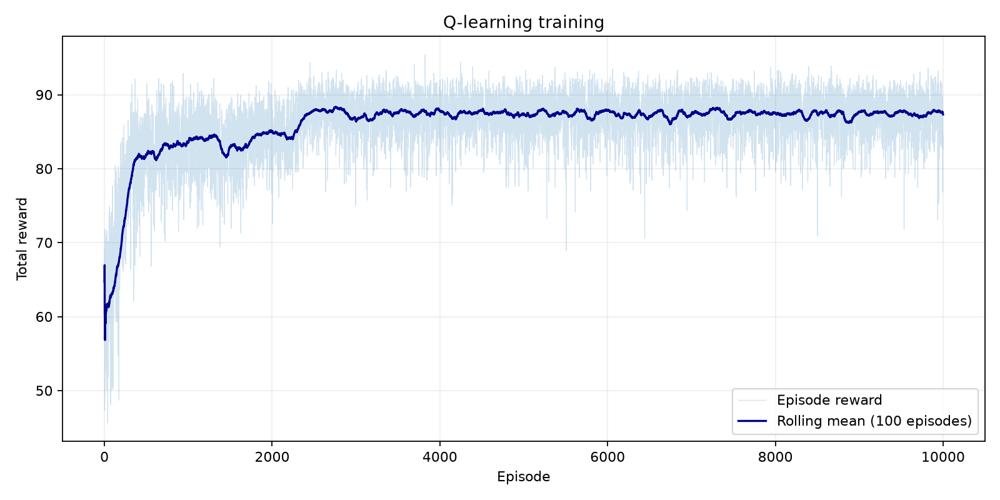
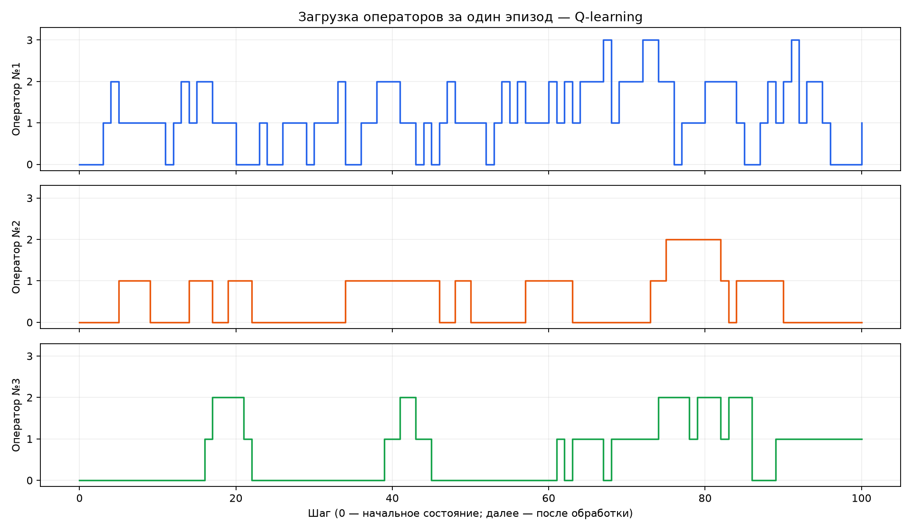
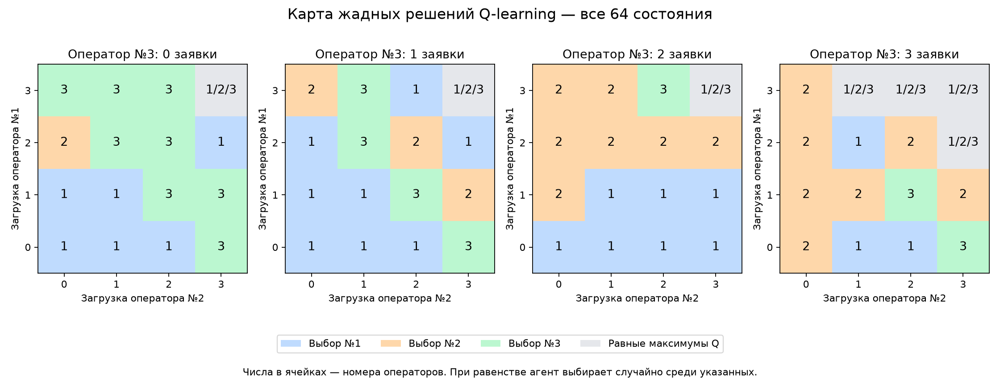

# Визуализация и оценка Q-learning

## Постановка

Агент распределяет по одной заявке за шаг между тремя операторами.
Ёмкость каждого — три заявки, вероятности завершения за шаг — 1/2, 1/4 и 1/6.
Состояние — загрузки операторов, всего 64 состояния и 3 действия.
Награда: число завершений минус 0,1 за каждую оставшуюся заявку
и минус 1 за отклонённую заявку. Отдельной очереди ожидания нет.

## Обучение и оценка

Обучение: 10 000 эпизодов по 100 шагов, alpha=0,1, gamma=0,95,
seed=42. Epsilon уменьшается от 1 до 0,01 с множителем 0,995 за эпизод.
Лимит эпизода трактуется как обрыв непрерывной задачи с сохранением bootstrap.
Оценка проводится без обучения на 1000 новых эпизодах для каждой стратегии.
При равных значениях выбор случайный, в том числе для Least Loaded.

| Стратегия | Средняя награда | Завершено за эпизод | Отказов за эпизод |
|---|---:|---:|---:|
| Random | 59,274 | 91,359 | 5,956 |
| Least Loaded | 74,643 | 97,664 | 0,001 |
| Q-learning | 84,877 | 98,596 | 0,014 |
| Самый быстрый доступный | 88,482 | 98,914 | 0,000 |

В этом эксперименте Q-learning превосходит Random и Least Loaded по средней
награде и числу завершений, но уступает Least Loaded по отказам и правилу
«самый быстрый доступный» по награде. Оптимальность политики не установлена.
Для устойчивого вывода нужны повторные обучения с разными seed.

## График обучения



Скользящее среднее растёт и стабилизируется. Это награды во время обучения,
когда политика меняется; оценка окончательной сохранённой таблицы приведена
отдельно выше и не обязана совпадать с последней точкой кривой.

## Загрузка операторов



Показан полный эпизод из 100 шагов с seed=200000. Начальное состояние
показано при шаге 0, остальные точки — после обработки заявок.
График показывает одновременно находящиеся в работе заявки, а не количество
назначений. Долгая занятость медленного оператора не означает частый выбор.
Исходные решения и переходы сохранены в agent_episode.csv.

## Карта решений



Четыре панели фиксируют загрузку третьего оператора от 0 до 3. Горизонтальная
ось — загрузка второго, вертикальная — первого. Каждая ячейка содержит
номер оператора с максимальным Q-значением; при равенстве перечислены все
варианты. Таким образом, показаны все 64 состояния, включая редко встречающиеся.
Равные и нулевые оценки не доказывают посещённость состояния: счётчики
посещений в сохранённой Q-таблице отсутствуют.

Политика не всегда избегает перегруженных операторов: например, в состоянии
(3, 2, 1) карта выбирает первого оператора. Это показывает ограничение
полученной политики и согласуется с ненулевым числом отказов.

## Воспроизведение

Из корня проекта с активированным виртуальным окружением:

```bash
python main.py --visualize
python main.py --demo
python main.py --demo --demo-seed 200001
```

Эти режимы загружают results/q_table.npy без повторного обучения.
Графики и CSV эпизода перезаписываются для выбранного seed.
Обычный python main.py запускает обучение, оценку и создание визуализаций.
